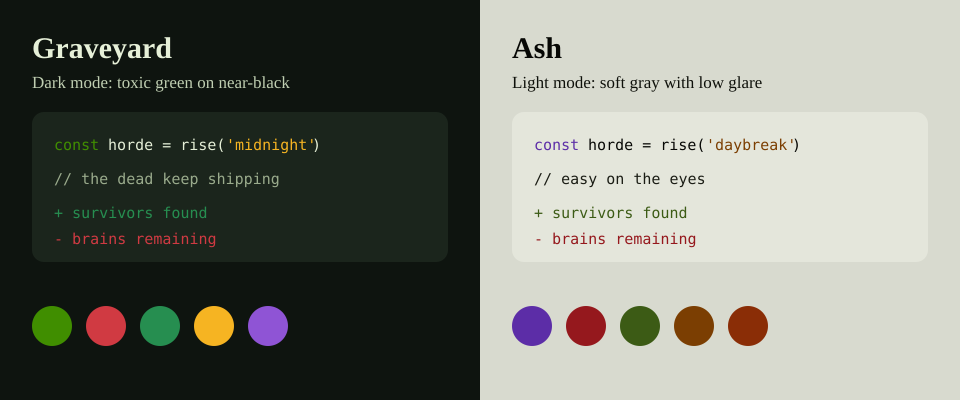

# Graveyard & Ash: a zombie theme for Claude

A custom **Claude theme** for the **Claude desktop app** and **Claude mobile app**, with a toxic-green dark mode and a low-glare gray light mode. It installs as a **Claude Code plugin** in about a minute.



*Illustrated color preview, not a screenshot.*

## The two looks

| Mode | Look | Colors |
|---|---|---|
| **Graveyard** (dark) | Near-black with a green tint | Toxic green, blood red, amber and bruise purple |
| **Ash** (light) | Soft gray that's easy on the eyes | Near-black text with deep purple, red, olive and rust |

The theme follows your app's light or dark setting automatically.

## Install

### Claude desktop app

1. Click **+** next to the prompt box.
2. Choose **Plugins**, then **Add marketplace**.
3. Enter `dannyzombie/claude-graveyard-ash-theme`.
4. Choose **Add plugin** and pick **zombie-theme**.
5. Start a new session.

### Claude Code terminal

Type this at the Claude Code prompt:

```
/plugin install zombie-theme --marketplace dannyzombie/claude-graveyard-ash-theme
```

Or run this from a shell:

```bash
claude plugin install zombie-theme --marketplace dannyzombie/claude-graveyard-ash-theme
```

## Where the theme shows

The colors appear in the Claude desktop and mobile apps. Terminals and code editors don't draw plugin themes, so the plugin installs there but the colors won't change.

## Change the colors

All the colors are in [`hooks/register.ts`](hooks/register.ts). Edit a value, then start a new session to see it.

## Uninstall

```bash
claude plugin uninstall zombie-theme
```

## License

The theme is released under the [MIT License](LICENSE). `hooks/make-colors.js` and `hooks/make-colors.d.ts` are helper files generated by Claude Code's plugin tools and are not covered by that license.
